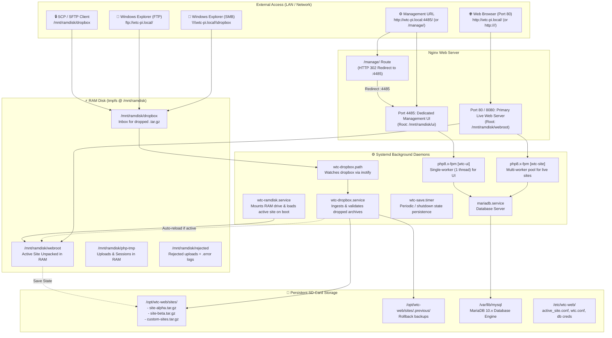

# WTC Pi RAM-Disk Web Server - Architecture & System Diagram

## 1. System Architecture Diagram

---

## 2. Component Directory & Function

| Component | Port / Path | Purpose | Storage Layer |
|---|---|---|---|
| **Live Web Server** | `http://<pi>/` (Port 80 & 8080) | Serves the primary active website directly at root (`/mnt/ramdisk/webroot`). | **RAM Disk** (`tmpfs`) |
| **Management Utility** | `http://<pi>:4485/` | Dedicated administration console: swap sites, stack installer, file transfer settings, save state. Runs on single worker process. | **RAM Disk** (`/mnt/ramdisk/ui`, synced from `/opt/wtc-web/ui`) |
| **MariaDB 10.x** | Local Socket / 3306 | Dedicated database engine with automatic per-site user & DB provisioning (`w_<site>`). | **Persistent** (`/var/lib/mysql`) |
| **Dropbox Ingest** | `\\<pi>\dropbox` or `/mnt/ramdisk/dropbox` | Drop any `<site>.tar.gz` to automatically create or update swappable sites. | **RAM Ingest** $\rightarrow$ **SD Storage** |
| **PHP-FPM [wtc-site]** | `/run/php/wtc-site.sock` | Dedicated multi-worker dynamic pool for live web applications. | Process / RAM |
| **PHP-FPM [wtc-ui]** | `/run/php/wtc-ui.sock` | Dedicated single-worker static pool (1 thread) for the management UI. | Process / RAM |
| **Save State** | CLI `--save-state` / UI button | Snapshots live RAM site modifications (uploads, data) back to the SD archive. | RAM $\rightarrow$ SD Archive |
| **Terminal CLI** | `sudo wtc-manage` | Whiptail-driven terminal menu and command-line management tool. | System binary |

---

## 3. Workflow Lifecycle

1. **Boot**: `wtc-ramdisk.service` mounts the `tmpfs` RAM disk before Nginx starts, reads `/etc/wtc-web/active_site.conf`, unpacks the active site archive into `/mnt/ramdisk/www`, provisions its MariaDB credentials, and allows Nginx to start.
2. **Serving**: Nginx serves requests on port 80 directly from volatile RAM disk, resulting in zero SD-card write cycles and maximum read throughput.
3. **Drop Ingest**: Dropping a `.tar.gz` into the dropbox triggers `wtc-dropbox.path`. The archive is validated, normalized, archived to `/opt/wtc-web/sites/` on the SD card, and immediately made available in the Management UI.
4. **Site Swapping**: Swapping sites via the Web UI or `wtc-manage` unpacks the chosen site to a staging directory in RAM, tests the Nginx configuration, atomically swaps the symlink, and reloads Nginx with zero downtime.
5. **Save State**: Any persistent runtime data (uploads, sqlite databases) can be snapshotted back to the persistent SD card storage on demand, on shutdown, or on a scheduled timer.
